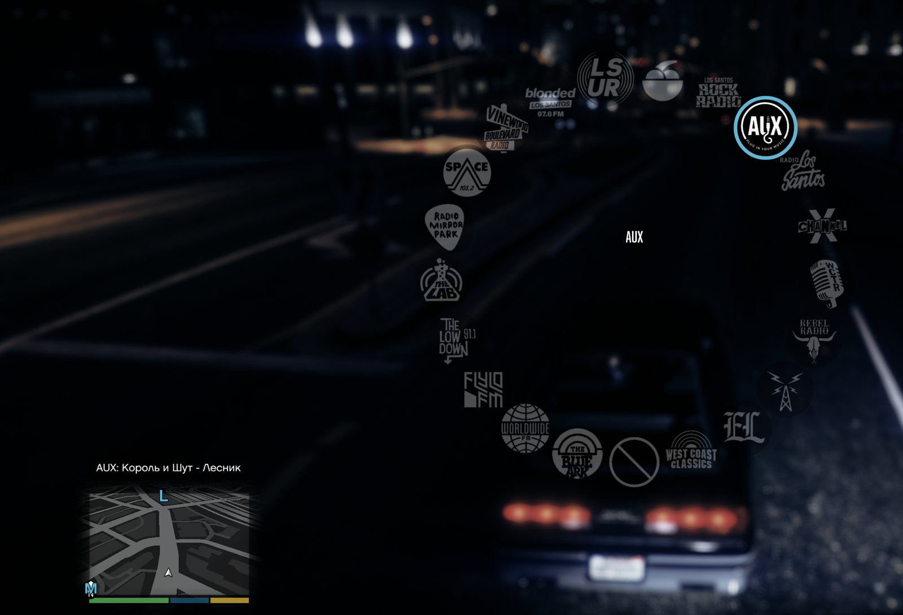
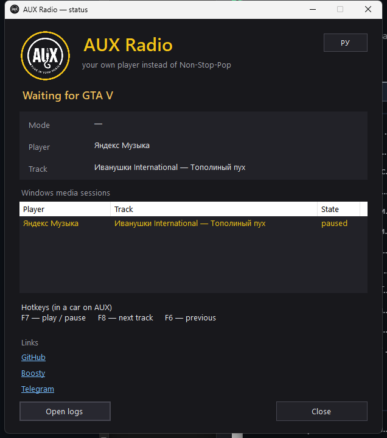

<div align="center">

# AUX Radio

**Your Spotify, Yandex Music or any Windows player as a GTA V Enhanced radio station — real artist and track in the radio wheel, one installer, no virtual cables.**

[](LICENSE)
[](https://github.com/timoncool/aux-radio/stargazers)
[](https://github.com/timoncool/aux-radio/commits)
[](https://github.com/timoncool/aux-radio/releases)
[](https://github.com/timoncool/aux-radio)

**English** · **[Русский](README.ru.md)**



</div>

## What it is

**AUX Radio** turns **Non-Stop-Pop FM** (`RADIO_02_POP`) in **GTA V Enhanced** into your own station: whatever is playing in Spotify, Yandex Music, AIMP, foobar2000, VLC, MusicBee or a browser becomes the soundtrack of your car.

The mod is a **remote control, not an audio engine**. Your player keeps playing through its own output — nothing is captured, rerouted or sent through a virtual cable, and Windows audio devices are not touched. The mod mutes the stock station, pauses and resumes the player together with the game, and puts the real artist and track into the radio wheel, the notification ticker and the dashboard.

Translation and radio voice-over stay intact: the installer changes **one GXT2 string and one HUD texture** inside `mods\update\update.rpf`, makes a backup first and restores both on uninstall.

## Features

- **Any player with a Windows media session** — Spotify, Yandex Music Desktop, AIMP, foobar2000, VLC, MusicBee, browsers.
- **No capture, no virtual cable** — the player plays itself; no loopback, no echo, no hum, no device changes.
- **Native radio behaviour** — F7 play/pause, F8 next, F6 previous; pauses when you leave the car or switch the station, resumes when you return, obeys game pause and cutscenes.
- **Track in the wheel** — the center of the radio wheel shows `Artist - Track` instead of the stock Pop track, plus the `AUX: Artist - Track` ticker and the in-car dashboard.
- **Station name and logo** — the wheel shows **AUX** with the *PLUG IN YOUR MUSIC* badge, installed with backup and removed on uninstall.
- **Mod-safe** — only the `mods\` overlay is touched; the game's original RPF files, translation and radio voice-over are untouched.
- **Agent lives with the game** — starts when the game loads, exits a few seconds after you quit; no Windows autostart.
- **RU / EN** — bilingual installer and a language switch in the status window.
- **One installer** — puts Script Hook V and ScriptHookVDotNet Enhanced only if they are missing, and removes only its own files.

## Requirements

- **GTA V Enhanced** on Windows 10/11 x64 (tested on 1.0.1158.16).
- A player that exposes a **Windows media session** and is playing.
- **Script Hook V + ScriptHookVDotNet Enhanced** — the installer adds them if missing.

## Quick start

1. **Download** `AUX_Radio_Setup_2.0.exe` from [Releases](https://github.com/timoncool/aux-radio/releases).
2. **Install** — run it and choose the GTA V Enhanced folder (the one with `GTA5_Enhanced.exe`).
3. **Play** — start your player, launch the game, get in a car and pick **AUX** in the radio wheel.

## Controls

| Key | Action |
|-----|--------|
| **F7** | Play / pause the player |
| **F8** | Next track |
| **F6** | Previous track |

Hotkeys work only while the car radio is on **AUX**.

## Status window

Double-click the tray icon (or run `GtaRadio.Agent.exe --status`):



It shows the game state, output mode, current player and track, every Windows media session, the hotkeys and links. The **EN / РУ** button switches the interface language.

## How it works

```text
Spotify / Yandex Music / any player
        │  plays through its own output (unchanged)
        ▼
GtaRadio.Agent (tray, .NET 8)
        │  Windows media sessions (SMTC) + media keys
        │  shared memory: track, state, commands
        ▼
GtaRadio.Mod.dll (Script Hook VDOT Net, in-game)
        │  occupies RADIO_02_POP, mutes the stock station,
        │  writes the track into the wheel labels and dashboard
        ▼
GTA V Enhanced — radio wheel, ticker, dashboard
```

- The station is muted with the game's own audio scenes and a frozen station track — the same approach as working Enhanced radio mods.
- The wheel center uses the game's track label table: the mod borrows the longest labels, redirects them to the player's track and returns the original text when the broadcast ends.
- The installer only edits `mods\update\update.rpf`: the `RADIO_02_POP` string in both language GXT2 files and the `gtav_radio_stations_texture_512` texture in `hud.ytd`. Backups are written next to the game; uninstall restores the current files.

## Build from source

```powershell
.\build.ps1 -GtaPatchDir <gta-patch folder> -ShvDir <folder with SHV/SHVDN> [-Deploy <game folder>] [-Iscc <ISCC.exe>]
```

Requirements: .NET SDK 8, Inno Setup 6, Script Hook V + ScriptHookVDotNet Enhanced for the payload. Details: [docs/BUILD.md](docs/BUILD.md), [docs/DEEPSEEK.md](docs/DEEPSEEK.md).

## Documentation

- [docs/BUILD.md](docs/BUILD.md) — build and deploy
- [docs/ARCHITECTURE.md](docs/ARCHITECTURE.md) — how the mod, agent and installer fit together
- [docs/MODS-MAP.md](docs/MODS-MAP.md) — the radio mods this project learned from
- [docs/HISTORY.md](docs/HISTORY.md) — from the 1.x capture engine to the current remote-control design

## Other Projects by [@timoncool](https://github.com/timoncool)

| Project | Description |
|---------|-------------|
| [Dub Studio](https://github.com/timoncool/dub-studio) | Offline AI video dubbing studio for Windows |
| [ACE-Step Studio](https://github.com/timoncool/ACE-Step-Studio) | Portable AI music studio — songs, vocals, covers |
| [VideoSOS](https://github.com/timoncool/videosos) | AI video production in the browser |
| [Bulka](https://github.com/timoncool/Bulka) | Live-coding music platform with an AI agent |
| [Foundation Music Lab](https://github.com/timoncool/Foundation-Music-Lab) | Music generation with a timeline editor |
| [Qwen3-TTS](https://github.com/timoncool/Qwen3-TTS_portable_rus) | Portable text-to-speech with voice cloning |

## Authors

- **Nerual Dreming** — [Telegram](https://t.me/nerual_dreming) | [neuro-cartel.com](https://neuro-cartel.com) | [ArtGeneration.me](https://artgeneration.me)

## Support the Author

I build open-source software and do AI research. Most of what I create is free and available to everyone. Your donations help me keep creating without worrying about where the next meal comes from =)

**[All donation methods](https://github.com/timoncool/ACE-Step-Studio/blob/master/DONATE.md)** | **[dalink.to/nerual_dreming](https://dalink.to/nerual_dreming)** | **[boosty.to/neuro_art](https://boosty.to/neuro_art)**

- **BTC:** `1E7dHL22RpyhJGVpcvKdbyZgksSYkYeEBC`
- **ETH (ERC20):** `0xb5db65adf478983186d4897ba92fe2c25c594a0c`
- **USDT (TRC20):** `TQST9Lp2TjK6FiVkn4fwfGUee7NmkxEE7C`

## Star History

<a href="https://www.star-history.com/?repos=timoncool%2Faux-radio&type=date&legend=top-left">
 <picture>
   <source media="(prefers-color-scheme: dark)" srcset="https://api.star-history.com/svg?repos=timoncool/aux-radio&type=date&theme=dark&legend=top-left" />
   <source media="(prefers-color-scheme: light)" srcset="https://api.star-history.com/svg?repos=timoncool/aux-radio&type=date&legend=top-left" />
   
 </picture>
</a>

## License

[MIT](LICENSE)
